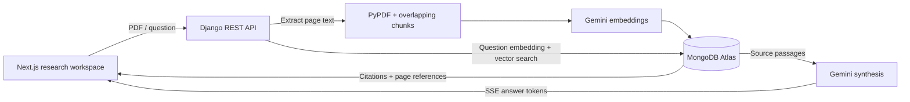

# RecallDesk

**Less searching. More understanding.**

RecallDesk is a document research workspace that puts answers and original evidence side by side. The portfolio demo works without credentials; the live path connects Next.js to a Django API, MongoDB Atlas Vector Search, and Gemini.

## Quick start (Full-stack)

Run both the Django backend and Next.js frontend concurrently with a single command from the project root:

```powershell
bun dev
```

- Frontend workspace: http://localhost:3000
- Django API: http://127.0.0.1:8000

## Explore the demo (Frontend only)

```powershell
cd frontend
bun install
bun run dev
```

Open http://localhost:3000. Ask one of the suggested questions, select an inline citation, save the answer, and revisit it in Saved research. The demo contains fictional excerpts and authored answers, clearly labeled throughout. It does not call an AI API or upload files.

## What is implemented

- Responsive workspace with document library, search, evidence desk, and mobile navigation.
- Inline citations and page-level excerpts for newly uploaded PDFs.
- Browser-local saved research, including source excerpts, and copy-to-clipboard.
- Live streamed answers with cancellation, Unicode-safe SSE parsing, explicit stream errors, and truncated-stream detection.
- PDF validation, 20 MB / 200-page / 500-chunk limits, scan-only and encrypted-file feedback, and best-effort cleanup on failed ingestion.
- Modern `google-genai` adapter with configurable models and 768-dimensional vectors.
- Restricted development CORS, environment-driven settings, and generic client-facing provider errors.

## Architecture



Retrieval is vector-only, not hybrid keyword/vector retrieval. Similarity scores are not confidence probabilities. Grounding is prompted and inspectable, but citations are not automatically verified for entailment.

## Live setup

Use Python 3.12 or later. Recreate the virtual environment if its interpreter has moved.

```powershell
cd backend
py -3.12 -m venv .venv
.\.venv\Scripts\Activate.ps1
python -m pip install -r requirements.txt
Copy-Item .env.example .env
```

Set `MONGODB_URI` to your Atlas connection string and `GEMINI_API_KEY` to your Gemini API key. The default database is `recalldesk` (override with `MONGODB_DATABASE`). API keys stay on the backend. Document passages and questions are sent to Gemini; extracted passages and vectors are stored in MongoDB. Original PDF files are not retained.

Create an Atlas Vector Search index named `vector_index` on `recalldesk.chunks`:

```json
{
  "fields": [
    { "type": "vector", "path": "embedding", "numDimensions": 768, "similarity": "cosine" }
  ]
}
```

```powershell
python manage.py runserver 8000
```

In the frontend, copy `.env.example` to `.env.local`. Change `NEXT_PUBLIC_API_URL` when your backend runs elsewhere; rebuild after changing it. Switch to **My library**, then upload a PDF. Atlas indexing is eventually consistent, so a newly uploaded document can take a short time to appear in search results.

The default models are `gemini-embedding-2` and `gemini-3.1-flash-lite`, following [Google's embedding documentation](https://ai.google.dev/gemini-api/docs/embeddings) and [model documentation](https://ai.google.dev/gemini-api/docs/models/gemini-3.1-flash-lite). Model availability depends on your account. When changing embedding models, use a fresh database and re-upload source documents: vectors from different models are not compatible, even with equal dimensions. The old `axiomvault` database is left untouched by the new default.

## Validation

```powershell
# frontend/
npm run lint
node --test tests/research.test.mjs
npm run build

# backend/ with environment activated
python manage.py test api
```

Tests cover split SSE frames and Unicode, interrupted responses, demo citation integrity, invalid requests, PDF validation, failed database writes, retrieval without sources, stream failures, and chunk boundaries. Provider and database calls are mocked in backend tests; these do not measure retrieval quality or verify live credentials.

## Portfolio walkthrough

1. Explain the problem: finding an answer is not enough if you cannot inspect its evidence.
2. Ask “What are our key product priorities?” in the demo.
3. Click citation 2 to reveal the customer interview passage and its limitations.
4. Save the finding, reload, and open it from Saved research.
5. Explain the architecture and the reliability tradeoffs above.

## Current boundaries

This is a single-user prototype, not a multi-tenant enterprise service. The API has no authentication or document ownership enforcement. Keep it private; a public portfolio deployment should expose only the standalone demo until authentication, quotas, and access control are implemented. Saved answers and excerpts remain in browser local storage until removed. PDF ingestion is synchronous; it does not perform OCR. Cleanup is best-effort, not a cross-collection transaction. Live retrieval quality and latency still need evaluation with a representative dataset.
